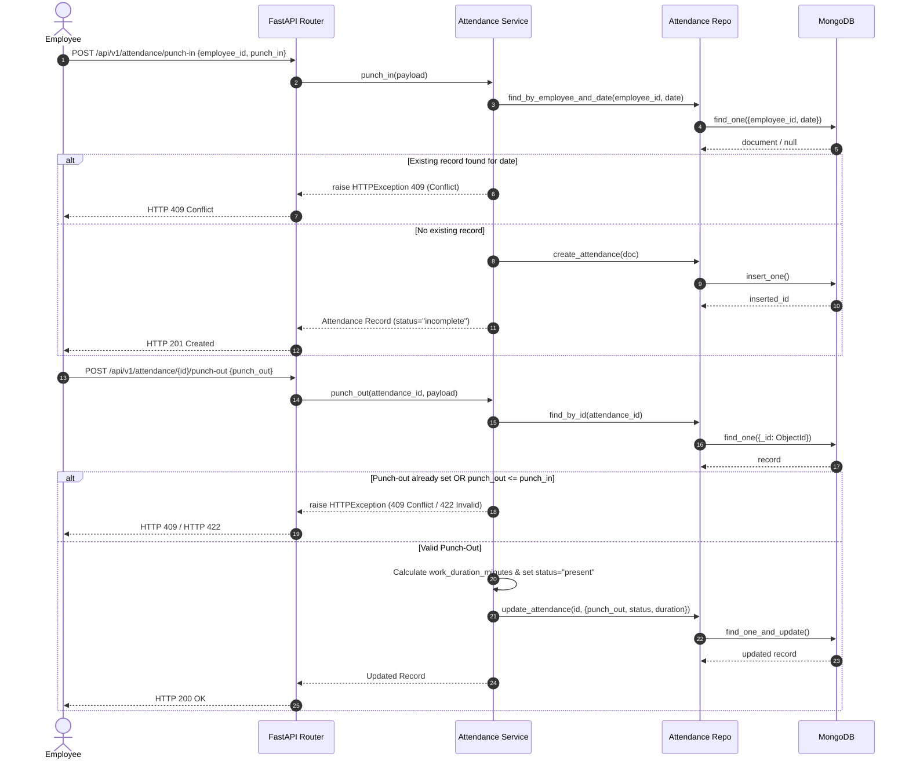
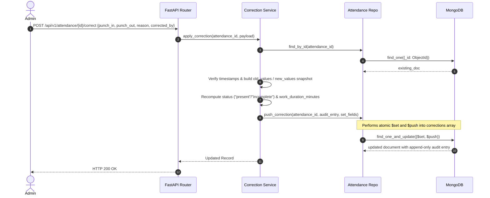
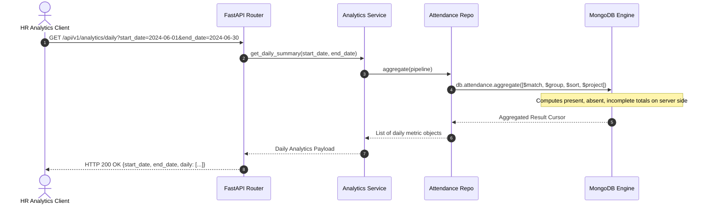

# 🏢 HROne Employee Attendance & Analytics REST API

[](https://www.python.org/)
[](https://fastapi.tiangolo.com/)
[](https://www.mongodb.com/)
[](https://docs.pydantic.dev/)
[](LICENSE)

A robust, enterprise-grade RESTful API for **Employee Attendance Tracking, Manual Corrections with Audit Trails, and Real-Time Analytics**, built with **FastAPI**, **MongoDB (PyMongo)**, and **Pydantic v2**. 

Designed for scalability and maintainability, this project implements a clean **3-Tier Layered Architecture** (Routes ➔ Services ➔ Repositories) and leverages **MongoDB Aggregation Pipelines** for high-performance server-side analytical calculations.

---

## 📋 Table of Contents
- [Executive Overview](#-executive-overview)
- [Key Features](#-key-features)
- [System Architecture & Design Patterns](#-system-architecture--design-patterns)
- [End-to-End Execution Flows](#-end-to-end-execution-flows)
  - [1. Punch-In & Punch-Out Flow](#1-punch-in--punch-out-flow)
  - [2. Manual Attendance Correction & Audit Log Flow](#2-manual-attendance-correction--audit-log-flow)
  - [3. Analytics Aggregation Pipeline Flow](#3-analytics-aggregation-pipeline-flow)
- [Project Directory Structure](#-project-directory-structure)
- [Database Schema & Indexes](#-database-schema--indexes)
- [API Reference & Endpoints](#-api-reference--endpoints)
  - [Health Check](#health-check)
  - [Attendance Endpoints](#attendance-endpoints)
  - [Correction Endpoints](#correction-endpoints)
  - [Analytics Endpoints](#analytics-endpoints)
- [MongoDB Aggregation Pipelines](#-mongodb-aggregation-pipelines)
- [Local Development & Setup Guide](#-local-development--setup-guide)
  - [Prerequisites](#prerequisites)
  - [Step-by-Step Installation](#step-by-step-installation)
  - [Environment Variables](#environment-variables)
  - [Running the Server](#running-the-server)
- [Database Seeding](#-database-seeding)
- [Automated Testing Suite](#-automated-testing-suite)
- [Error Handling & HTTP Status Codes](#-error-handling--http-status-codes)

---

## 🌟 Executive Overview

In modern workforce management systems, accurate attendance logging and transparent auditability are critical. The **HROne Employee Attendance & Analytics API** provides complete lifecycle management for workforce attendance:

- **Strict Validation Rules**: Enforces single punch-in per employee per calendar day (UTC) and prevents out-of-order or duplicate punch-outs.
- **Append-Only Audit Trail**: Captures full historical context for every administrative correction without destroying original data.
- **High-Performance Analytics**: Offloads daily, per-employee, and organization-wide summary aggregations directly to MongoDB engine via `$group` and `$cond` operations.

---

## ✨ Key Features

- ⏱️ **Real-time Attendance Lifecycle**: Punch-in (`incomplete` status) and Punch-out (`present` status with automatic work duration computation in minutes).
- 🛡️ **Conflict & Error Prevention**: Built-in validation rejecting duplicate punch-ins (`HTTP 409`), duplicate punch-outs (`HTTP 409`), and punch-out before punch-in (`HTTP 422`).
- 📝 **Immutable Audit Logging**: Administrative timestamp corrections log `old_values`, `new_values`, `reason`, `corrected_by`, and `corrected_at` into an append-only array.
- 📊 **Advanced Analytics Engine**:
  - **Daily Aggregations**: Total present, absent, and incomplete counts per day.
  - **Employee Performance Metrics**: Work days summary, total work minutes, and average daily work duration.
  - **Overall Summary**: Organization-level totals for any date range.
- 🚀 **Asynchronous & Scalable**: Modern FastAPI codebase with Pydantic v2 schemas and explicit MongoDB index creation.

---

## 🏗️ System Architecture & Design Patterns

The codebase strictly adheres to the **Layered (3-Tier) Architecture** to ensure separation of concerns, easy testability, and maintainability:

```
                  ┌─────────────────────────────────────────┐
                  │          FastAPI Client / HTTP          │
                  └────────────────────┬────────────────────┘
                                       │
                                       ▼
                  ┌─────────────────────────────────────────┐
                  │       API Routes Layer (Thin Handlers)  │
                  │   app/api/routes/*.py                   │
                  └────────────────────┬────────────────────┘
                                       │
                                       ▼
                  ┌─────────────────────────────────────────┐
                  │      Service Layer (Business Logic)     │
                  │   app/services/*.py                     │
                  └────────────────────┬────────────────────┘
                                       │
                                       ▼
                  ┌─────────────────────────────────────────┐
                  │     Repository Layer (Database Access)  │
                  │   app/repositories/*.py                 │
                  └────────────────────┬────────────────────┘
                                       │
                                       ▼
                  ┌─────────────────────────────────────────┐
                  │       MongoDB Database (PyMongo)        │
                  │   Collection: 'attendance'              │
                  └─────────────────────────────────────────┘
```

- **Routes Layer**: Accepts requests, validates input using Pydantic schemas, and calls services.
- **Service Layer**: Handles core business logic, status transitions, duration computations, and error throwing.
- **Repository Layer**: Encapsulates raw PyMongo queries, document conversions, and aggregation executions.

---

## 🔄 End-to-End Execution Flows

### 1. Punch-In & Punch-Out Flow



### 2. Manual Attendance Correction & Audit Log Flow



### 3. Analytics Aggregation Pipeline Flow



---

## 📁 Project Directory Structure

```text
employee-attendance-analytics-api/
├── app/
│   ├── api/                     # Router registry & endpoint controllers
│   │   ├── routes/
│   │   │   ├── analytics.py     # Aggregation endpoints (daily, employee, overall)
│   │   │   ├── attendance.py    # Punch-in, Punch-out, retrieval endpoints
│   │   │   └── corrections.py   # Manual adjustment & audit trail endpoints
│   │   └── router.py            # Master API v1 router definition
│   ├── core/                    # System infrastructure & configuration
│   │   ├── config.py            # Pydantic Settings (.env configuration loader)
│   │   ├── database.py          # PyMongo connection, lifecycle & index management
│   │   └── logging.py           # Structured application logging setup
│   ├── models/                  # Domain entity definitions
│   │   └── attendance.py        # Attendance model dictionary constants
│   ├── repositories/            # Data Access Layer
│   │   └── attendance_repository.py # MongoDB queries, updates, and pipelines
│   ├── schemas/                 # Data validation & serialization (Pydantic v2)
│   │   ├── analytics.py         # Summary response models
│   │   ├── attendance.py        # Punch-in/out request & response models
│   │   └── correction.py        # Correction request & audit entry models
│   ├── services/                # Business Logic Layer
│   │   ├── analytics_service.py # Aggregation pipeline logic
│   │   ├── attendance_service.py# Punch logic & time calculations
│   │   └── correction_service.py# Audit trail builder & correction handler
│   └── main.py                  # FastAPI application entrypoint & exception handlers
├── docs/                        # Project documentation assets
├── scripts/
│   └── seed_data.py             # Idempotent database seeder for demo data
├── tests/                       # Comprehensive test suite (Pytest)
│   ├── conftest.py              # Test fixtures, mock DB setup, client initialization
│   ├── test_analytics.py        # Analytics aggregation tests
│   ├── test_attendance.py       # Punch-in / punch-out business rule tests
│   ├── test_corrections.py      # Audit trail & manual correction tests
│   └── test_health.py           # Health check endpoint test
├── .env.example                 # Environment configuration template
├── .gitignore                   # Git exclusion rules
├── pyproject.toml               # Project metadata & build tool configuration
├── REQUIREMENTS.md              # Functional & non-functional project requirements
├── requirements.txt             # Locked dependencies list
└── README.md                    # Main repository documentation
```

---

## 🗄️ Database Schema & Indexes

The application uses MongoDB collection named **`attendance`**.

### Document Schema Structure
```json
{
  "_id": ObjectId("66619a8f12c4b8e90a123456"),
  "employee_id": "EMP001",
  "date": "2024-06-01",
  "punch_in": ISODate("2024-06-01T09:00:00Z"),
  "punch_out": ISODate("2024-06-01T17:30:00Z"),
  "status": "present",
  "work_duration_minutes": 510,
  "corrections": [
    {
      "corrected_at": ISODate("2024-06-02T10:00:00Z"),
      "corrected_by": "HR_ADMIN_01",
      "reason": "Forgot to punch in on time due to system maintenance",
      "old_values": {
        "punch_in": ISODate("2024-06-01T09:30:00Z")
      },
      "new_values": {
        "punch_in": ISODate("2024-06-01T09:00:00Z")
      }
    }
  ],
  "created_at": ISODate("2024-06-01T09:00:00Z"),
  "updated_at": ISODate("2024-06-02T10:00:00Z")
}
```

### Database Indexes
Indexes are automatically created on startup via `_ensure_indexes()` in `app/core/database.py`:
1. `employee_punch_in`: Compound index `[("employee_id", ASCENDING), ("punch_in", DESCENDING)]` for quick employee history lookup.
2. `attendance_date`: Index `[("date", ASCENDING)]` for fast date-range filtering during aggregation runs.
3. `attendance_status`: Index `[("status", ASCENDING)]` for status query filtering.

---

## 🔌 API Reference & Endpoints

### Health Check
- `GET /health` — Application health check (returns status `ok`).

---

### Attendance Endpoints

#### 1. Record Punch-In
- **Endpoint**: `POST /api/v1/attendance/punch-in`
- **Description**: Records a punch-in event. Generates a new attendance document with status `incomplete`. Restricts duplicate punch-ins per employee per calendar day.
- **Request Payload**:
  ```json
  {
    "employee_id": "EMP001",
    "punch_in": "2024-06-01T09:00:00Z"
  }
  ```
- **Response (`201 Created`)**:
  ```json
  {
    "_id": "66619a8f12c4b8e90a123456",
    "employee_id": "EMP001",
    "date": "2024-06-01",
    "punch_in": "2024-06-01T09:00:00Z",
    "punch_out": null,
    "status": "incomplete",
    "work_duration_minutes": null,
    "created_at": "2024-06-01T09:00:00Z",
    "updated_at": "2024-06-01T09:00:00Z"
  }
  ```

#### 2. Record Punch-Out
- **Endpoint**: `POST /api/v1/attendance/{attendance_id}/punch-out`
- **Description**: Records punch-out timestamp. Updates status to `present` and automatically calculates `work_duration_minutes`.
- **Request Payload**:
  ```json
  {
    "punch_out": "2024-06-01T17:30:00Z"
  }
  ```
- **Response (`200 OK`)**:
  ```json
  {
    "_id": "66619a8f12c4b8e90a123456",
    "employee_id": "EMP001",
    "date": "2024-06-01",
    "punch_in": "2024-06-01T09:00:00Z",
    "punch_out": "2024-06-01T17:30:00Z",
    "status": "present",
    "work_duration_minutes": 510,
    "created_at": "2024-06-01T09:00:00Z",
    "updated_at": "2024-06-01T17:30:00Z"
  }
  ```

#### 3. Get Attendance Record by ID
- **Endpoint**: `GET /api/v1/attendance/{attendance_id}`
- **Response (`200 OK`)**: Returns full attendance record including corrections array.

#### 4. List Employee Attendance History
- **Endpoint**: `GET /api/v1/attendance/employee/{employee_id}?skip=0&limit=50`
- **Response (`200 OK`)**: Returns list of attendance records ordered newest first.

---

### Correction Endpoints

#### 1. Apply Manual Correction
- **Endpoint**: `POST /api/v1/attendance/{attendance_id}/correct`
- **Description**: Adjusts `punch_in` and/or `punch_out`. Re-calculates status and work duration while appending a snapshot to the `corrections` list.
- **Request Payload**:
  ```json
  {
    "punch_in": "2024-06-01T08:55:00Z",
    "reason": "Corrected initial punch time per manager approval",
    "corrected_by": "HR_ADMIN_01"
  }
  ```
- **Response (`200 OK`)**: Returns updated record with audit entry in `corrections`.

#### 2. Get Correction Audit Trail
- **Endpoint**: `GET /api/v1/attendance/{attendance_id}/corrections`
- **Response (`200 OK`)**: Returns list of all audit trail entries for the specified attendance ID.

---

### Analytics Endpoints

#### 1. Daily Summary
- **Endpoint**: `GET /api/v1/analytics/daily?start_date=2024-06-01&end_date=2024-06-30`
- **Response (`200 OK`)**:
  ```json
  {
    "start_date": "2024-06-01",
    "end_date": "2024-06-30",
    "daily": [
      {
        "date": "2024-06-01",
        "total_employees": 5,
        "present": 4,
        "absent": 0,
        "incomplete": 1
      }
    ]
  }
  ```

#### 2. Per-Employee Summary
- **Endpoint**: `GET /api/v1/analytics/employees?start_date=2024-06-01&end_date=2024-06-30`
- **Response (`200 OK`)**:
  ```json
  {
    "start_date": "2024-06-01",
    "end_date": "2024-06-30",
    "employees": [
      {
        "employee_id": "EMP001",
        "total_days": 20,
        "present_days": 19,
        "absent_days": 0,
        "incomplete_days": 1,
        "total_work_minutes": 9690,
        "average_work_minutes": 510.0
      }
    ]
  }
  ```

#### 3. Overall Organization Summary
- **Endpoint**: `GET /api/v1/analytics/summary` (Optional query params: `start_date`, `end_date`)
- **Response (`200 OK`)**:
  ```json
  {
    "total_records": 100,
    "total_present": 95,
    "total_absent": 2,
    "total_incomplete": 3,
    "total_work_minutes": 48450
  }
  ```

---

## 📊 MongoDB Aggregation Pipelines

All analytical aggregation is executed directly in MongoDB to ensure optimal performance.

Example pipeline for **Daily Summary** (`get_daily_summary`):
```python
pipeline = [
    {"$match": {"date": {"$gte": start_date, "$lte": end_date}}},
    {
        "$group": {
            "_id": "$date",
            "total_employees": {"$sum": 1},
            "present": {
                "$sum": {"$cond": [{"$eq": ["$status", "present"]}, 1, 0]}
            },
            "absent": {
                "$sum": {"$cond": [{"$eq": ["$status", "absent"]}, 1, 0]}
            },
            "incomplete": {
                "$sum": {"$cond": [{"$eq": ["$status", "incomplete"]}, 1, 0]}
            },
        }
    },
    {"$sort": {"_id": 1}},
    {
        "$project": {
            "_id": 0,
            "date": "$_id",
            "total_employees": 1,
            "present": 1,
            "absent": 1,
            "incomplete": 1,
        }
    },
]
```

---

## ⚙️ Local Development & Setup Guide

### Prerequisites
- **Python**: 3.11 or higher
- **MongoDB**: Local MongoDB instance (`mongodb://localhost:27017`) OR MongoDB Atlas URI.

### Step-by-Step Installation

1. **Clone the repository**:
   ```bash
   git clone https://github.com/kishore-9000/employee-attendance-analytics-api.git
   cd employee-attendance-analytics-api
   ```

2. **Create and activate a virtual environment**:
   - **Linux / macOS**:
     ```bash
     python3 -m venv .venv
     source .venv/bin/activate
     ```
   - **Windows (PowerShell)**:
     ```powershell
     python -m venv .venv
     .\.venv\Scripts\Activate.ps1
     ```

3. **Install dependencies**:
   ```bash
   pip install -r requirements.txt
   ```
   *For development setup (including pytest and httpx):*
   ```bash
   pip install -e ".[dev]"
   ```

4. **Environment Configuration**:
   Copy `.env.example` to create `.env`:
   ```bash
   cp .env.example .env
   ```

### Environment Variables
Edit `.env` as required:
```env
MONGODB_URI=mongodb://localhost:27017
MONGODB_DATABASE=attendance_db
APP_ENV=development
APP_HOST=0.0.0.0
APP_PORT=8000
LOG_LEVEL=INFO
```

### Running the Server
Start the FastAPI server using Uvicorn:
```bash
uvicorn app.main:app --reload
```
- Interactive Swagger API Documentation: [http://localhost:8000/docs](http://localhost:8000/docs)
- ReDoc API Documentation: [http://localhost:8000/redoc](http://localhost:8000/redoc)

---

##  🌱 Database Seeding

To load a realistic 30-day demonstration dataset (June 2024) for employees `EMP001` through `EMP005`:

```bash
python scripts/seed_data.py
```
*Note: The script is idempotent and safe to execute multiple times without producing duplicate entries.*

---

## 🧪 Automated Testing Suite

The project includes unit and integration tests powered by **Pytest** and **HTTPX**:

```bash
pytest
```
or
```bash
python -m pytest
```

### Test Coverage Highlights
- **`test_attendance.py`**: Verifies punch-in creation, duplicate prevention (`HTTP 409`), punch-out duration calculations, and timestamp validation (`HTTP 422`).
- **`test_corrections.py`**: Verifies manual corrections, status updates, and append-only audit trail integrity.
- **`test_analytics.py`**: Validates daily, employee, and overall aggregation results against mock MongoDB database setups.
- **`test_health.py`**: Verifies health check status response.

---

## 🚨 Error Handling & HTTP Status Codes

| Status Code | Description | Scenario |
| :--- | :--- | :--- |
| `200 OK` | Request succeeded | Retrieval, successful punch-out, correction, or analytics fetch. |
| `201 Created` | Resource created | Successful punch-in recording. |
| `404 Not Found` | Resource not found | Invalid attendance ID specified. |
| `409 Conflict` | Business rule conflict | Punch-in attempt on a day where attendance already exists, or double punch-out attempt. |
| `422 Unprocessable Entity` | Schema or rule validation error | Invalid date formats, missing fields, or `punch_out` timestamp prior to `punch_in`. |
| `503 Service Unavailable` | Database connectivity failure | PyMongo connection error or database unreachable. |

---

## 📜 License
This project is licensed under the MIT License - see the [LICENSE](LICENSE) file for details.
